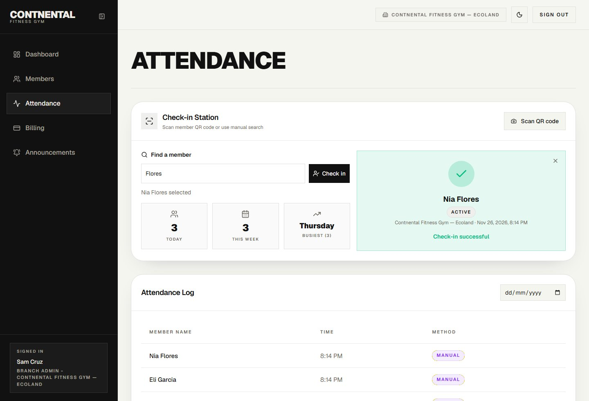
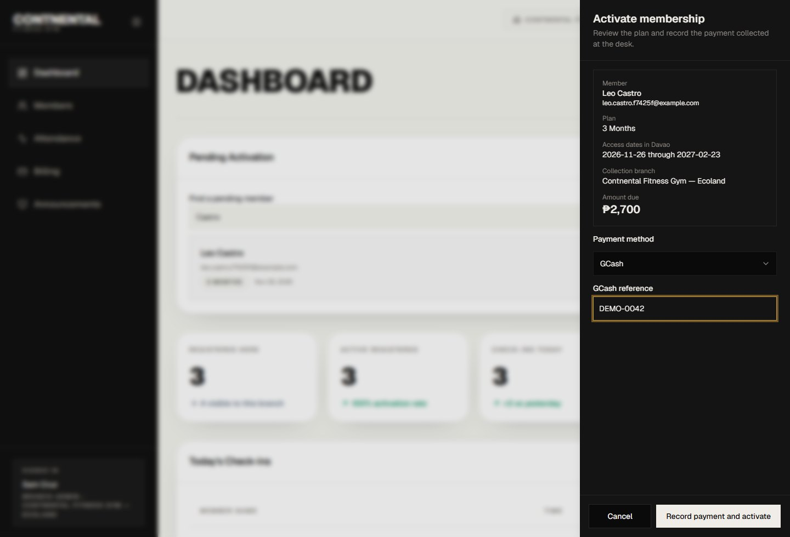
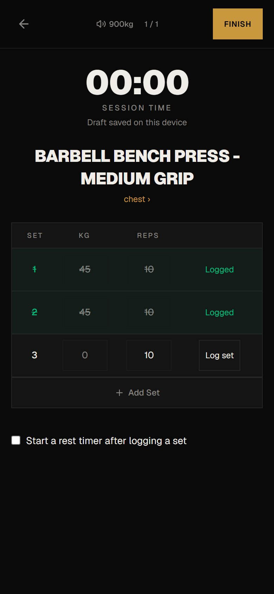
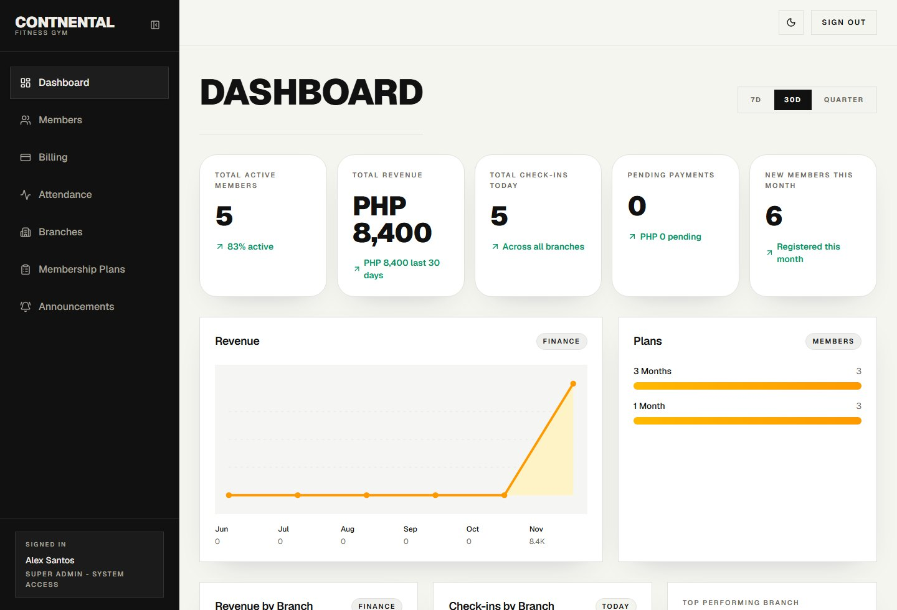
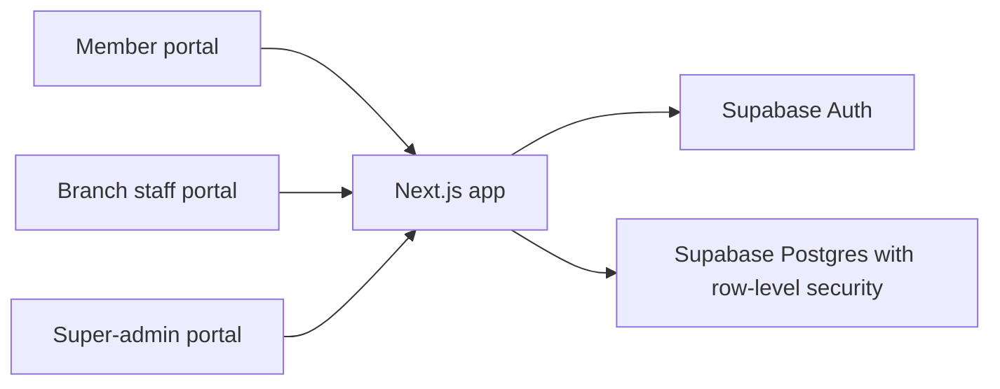

# Contnental Fitness Gym

Contnental is a web app for a multi-branch gym in Davao City. Members can track their training and present a QR code at the front desk. Staff use the same system to activate memberships, record payments, and track visits across locations.

[Demo screenshots](#demo-screenshots) · [Architecture](#architecture) · [Local setup](docs/GETTING_STARTED.md)

## Demo screenshots

These screens were captured from the running app using fictional accounts, payments, and visits.

### Branch check-in

Staff can scan a member’s QR code or search by name. This screen shows a successful manual check-in and the branch attendance log.

### Membership activation

Staff review the plan, access dates, and amount due before recording a cash or GCash payment and activating the membership.

### Member workout log

Members record weight and reps during a workout. Completed sets appear alongside the next set to log.

### Super-admin dashboard

The dashboard shows membership, revenue, and attendance totals across branches.

## How it works

After a member picks a plan and verifies their email, the app creates a pending membership. Branch staff can assign the member to a branch, activate the plan, and record payment. On later visits, staff can scan the member’s QR code or look them up manually. The attendance record belongs to the location where the visit occurred.

| Portal | What it supports |
| --- | --- |
| Member · `/dashboard` | View membership status, build workout routines, log sets and reps, track body measurements, and show a check-in QR code. |
| Branch admin · `/branch` | Register walk-ins, activate memberships, handle QR and manual check-ins, and record branch payments. |
| Super admin · `/admin` | Manage membership plans and branch details, review activity across branches, publish announcements, and export member and billing CSVs. |

## Architecture

The member, branch staff, and super-admin portals run in one Next.js 16 App Router app with React 19, TypeScript, and Tailwind CSS. Supabase Auth handles sign-in and sessions, while Postgres stores membership, payment, attendance, and workout records.

The [architecture guide](docs/ARCHITECTURE.md) covers the data model, access rules, and HTTP endpoints.

## Engineering highlights

- **Branch-aware operations.** A member’s home branch, the branch they visit, and the branch that collects a payment are tracked independently. Staff can look up members across locations for check-in while attendance writes use the staff member’s assigned branch.
- **Role checks at multiple layers.** Next.js layouts route staff and members to their portals. Server Actions check permissions for staff operations, and Supabase row-level security applies to queries made with user sessions.
- **Workout history survives routine edits.** Completed sessions store their own exercise names and set data, so changing or deleting a saved routine preserves the original workout log.

## Run locally

Use the Node.js LTS version in [`.nvmrc`](.nvmrc), npm, and a development Supabase project. The [setup guide](docs/GETTING_STARTED.md) covers database initialization, signup email codes, staff accounts, and a manual walkthrough.

## Current status

Staff record cash and GCash payments manually. The optional AI coach is disabled by default and supports Ollama, Groq, or OpenAI when configured.
