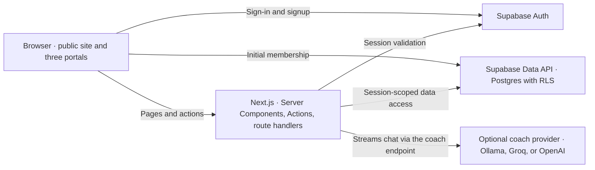
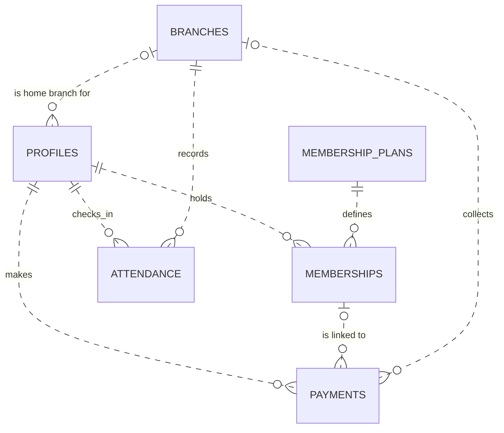

# Architecture

[Project overview](../README.md) · [Local setup](GETTING_STARTED.md)

## System overview

The public website and the member, branch-admin, and super-admin portals run in one Next.js App Router application. Server Components read dashboard data through a Supabase client associated with the current session. Client Components handle interactions such as the QR scanner and workout editor. Most writes use Server Actions. The browser talks directly to Supabase for sign-in, signup, code verification, and creation of the initial pending membership.

| Code | Responsibility |
| --- | --- |
| [`app/`](../app/) | Route groups, portal layouts, Server Actions, and HTTP handlers. |
| [`components/`](../components/) | The public site, interactive portal screens, and shared UI primitives. |
| [`lib/`](../lib/) | Supabase clients and role resolution, dashboard data access, membership selection, and announcement filtering. |
| [`supabase/`](../supabase/) | Tables, seed data, row-level policies, role helpers, and database triggers. |

## Identity and authorization

Supabase Auth handles email, password, and signup verification. The session is stored in cookies via `@supabase/ssr`. The app’s [request middleware](../middleware.ts) refreshes sessions and redirects users on common portal paths. The portal layouts also check the user and role. [Role resolution](../lib/supabase/roles.ts) looks up `user_roles` first, falls back to `profiles`, and defaults to member routing when neither lookup returns a role.

The database creates a profile at signup. A [trigger](../supabase/patch-fix-role-routing.sql) mirrors profile role and branch changes to `user_roles`. Postgres policies can query that dedicated table through helper functions, avoiding role checks that must query `profiles` from within profile policies.

Branch access depends on the operation. Staff can look up members from other locations for check-in, while the attendance action writes the staff member’s assigned branch. Branch billing queries filter on the collection branch. Only walk-in Auth creation and the optional coach meter use the [server-only Supabase client](../lib/supabase/admin.ts). That client bypasses row-level security. Walk-in provisioning checks the branch role and required MFA before creating an Auth user. The Auth account remains recoverable through “Complete registration” when the separate database transaction cannot be confirmed.

## Membership and attendance

1. **Signup.** The member selects a plan and verifies the email code. Before signup, a Server Action can check for a duplicate email when the backend key is configured. After verification, the registration screen looks up the selected plan by name before attempting to create a `PENDING` membership.
2. **Activation.** Branch staff select a pending registration. The app assigns an unassigned member to the branch, changes the membership to `ACTIVE` with plan-derived dates, and writes a confirmed payment record. Cash and GCash are recorded by staff.
3. **Check-in.** Staff scan the member’s QR code or use manual search. The attendance action looks up membership status and checks for a visit already recorded that day before inserting attendance at the staff member’s branch.

Enrollment, settlement, and visit recording run through the [pilot operations migration](../supabase/migrations/20261126000200_pilot_operations.sql). Settlement locks the member and commits branch assignment, payment, and activation together. Repeating the same settlement returns the existing receipt. Visit recording holds the member lock, checks the membership's effective dates, and keeps a single visit per member per Manila business date across branches. The attendance row records the visited branch and staff operator. Staff MFA can be required at the database boundary.

## Data model

- **Branch attribution.** `profiles.branch_id` is the member’s home branch or a staff member’s assigned branch. `payments.branch_id` identifies the location that collected payment. `attendance.branch_id` identifies where the visit occurred. The collection-branch patch backfills older payments from the associated profile where a branch is available.
- **Training history.** `routines` and `routine_exercises` store editable templates. `workout_sessions.exercises` stores the exercise names and set data for the completed workout as JSONB. The session also stores the routine name, so history can still show the original details after a routine changes or is deleted. `body_metrics` stores dated measurements. The exercise picker reads a [bundled catalog](../public/data/exercises.json).
- **Announcements.** The super admin can target all branches or selected branches and set a future publish time. The [feed query layer](../lib/announcements.ts) filters sent items by publication time and branch for portal display. RLS also requires publication time and audience membership.

The database is defined by the [ordered migrations](../supabase/migrations). See [database setup](GETTING_STARTED.md#initialize-the-database) for the fresh and legacy paths.

## HTTP endpoints

| Endpoint | Contract | Behavior |
| --- | --- | --- |
| [`GET /auth/callback`](../app/auth/callback/route.ts) | A Supabase auth code in `code`, with an optional `next` path. | Exchanges the code for a session and redirects. The default destination resolves to the user’s role-based portal. Failed exchanges redirect to `/login?error=auth`. |
| [`POST /auth/signout`](../app/auth/signout/route.ts) | The browser’s session cookies. | Signs out through Supabase and redirects to `/login` with HTTP 302. |
| [`POST /api/coach`](../app/api/coach/route.ts) | A signed-in session and a JSON body with chat `messages` and the member `context`. | Streams `data:` frames containing JSON, such as `{"token":"Warm up"}` and `{"done":true}`. The handler returns 401 without a session, 400 for a missing or empty message list, and 502 when it cannot reach the model or obtain a usable upstream response. |

### AI coach

The coach is disabled by default. For an authorized cohort, `/api/coach` accepts bounded chat history and an optional request to include recent sets from the authenticated member. Workout context contains only exercise names from the bundled catalog, weights, and repetitions. The route excludes identity and billing fields. A shared database reservation limits spend and concurrency across app instances. The provider adapter normalizes Ollama NDJSON and Groq or OpenAI SSE as event streams for the browser.

See the [pilot runbook](PILOT_RUNBOOK.md#coach-evaluation) for the provider evaluation and rollout checks.
