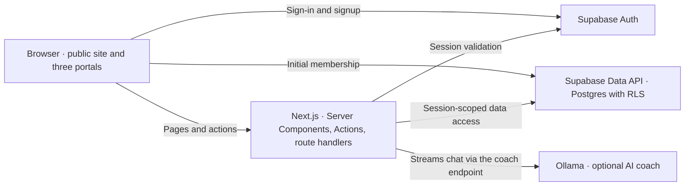
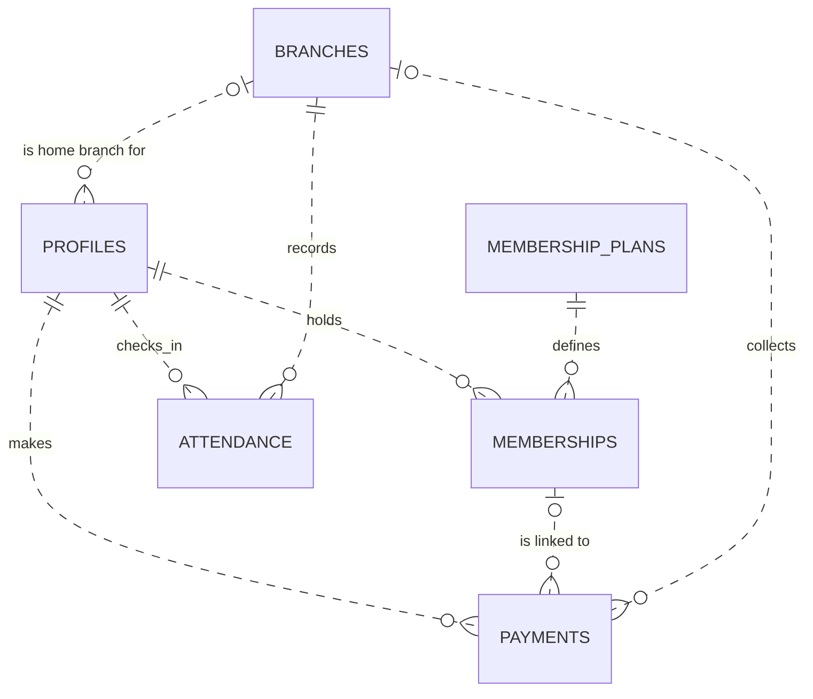

# Architecture

[Project overview](../README.md) · [Local setup](GETTING_STARTED.md)

## System overview

The public website and the member, branch-admin, and super-admin portals run in one Next.js App Router application. Server Components read dashboard data through a Supabase client associated with the current session. Client Components handle interactions such as the QR scanner and workout editor. Most writes use Server Actions. The browser talks directly to Supabase for sign-in, signup, code verification, and creation of the initial pending membership.

| Code | Responsibility |
| --- | --- |
| [`app/`](../app/) | Route groups, portal layouts, Server Actions, and HTTP handlers. |
| [`components/`](../components/) | The public site, interactive portal screens, and shared UI primitives. |
| [`lib/`](../lib/) | Supabase clients and role resolution, dashboard data access, membership selection, and announcement filtering. |
| [`supabase/`](../supabase/) | Tables, seed data, row-level policies, role helpers, and database triggers. |

## Identity and authorization

Supabase Auth handles email, password, and signup verification. The session is stored in cookies via `@supabase/ssr`. The app’s [request middleware](../middleware.ts) refreshes sessions and redirects users on common portal paths. The portal layouts also check the user and role. [Role resolution](../lib/supabase/roles.ts) looks up `user_roles` first, falls back to `profiles`, and defaults to member routing when neither lookup returns a role.

The database creates a profile at signup. A [trigger](../supabase/patch-fix-role-routing.sql) mirrors profile role and branch changes to `user_roles`. Postgres policies can query that dedicated table through helper functions, avoiding role checks that must query `profiles` from within profile policies.

Branch access depends on the operation. Staff can look up members from other locations for check-in, while the attendance action writes the staff member’s assigned branch. Branch billing queries filter on the collection branch. The staff actions for walk-in registration and completion of an existing account can use a [server-only Supabase client](../lib/supabase/admin.ts). That client bypasses row-level security, so the branch-admin check in each action is part of the authorization boundary.

## Membership and attendance

1. **Signup.** The member selects a plan and verifies the email code. Before signup, a Server Action can check for a duplicate email when the backend key is configured. After verification, the registration screen looks up the selected plan by name before attempting to create a `PENDING` membership.
2. **Activation.** Branch staff select a pending registration. The app assigns an unassigned member to the branch, changes the membership to `ACTIVE` with plan-derived dates, and writes a confirmed payment record. Cash and GCash are recorded by staff.
3. **Check-in.** Staff scan the member’s QR code or use manual search. The attendance action looks up membership status and checks for a visit already recorded that day before inserting attendance at the staff member’s branch.

The [branch activation action](../app/(branch)/branch/actions.ts) uses separate database writes for branch assignment, membership activation, and payment recording. If the last write fails, the earlier writes can remain in place. The [attendance action](../app/(branch)/branch/attendance/actions.ts) checks for duplicates in application code using the server’s calendar day. The schema has no uniqueness constraint for one visit per member per day.

## Data model

- **Branch attribution.** `profiles.branch_id` is the member’s home branch or a staff member’s assigned branch. `payments.branch_id` identifies the location that collected payment. `attendance.branch_id` identifies where the visit occurred. The collection-branch patch backfills older payments from the associated profile where a branch is available.
- **Training history.** `routines` and `routine_exercises` store editable templates. `workout_sessions.exercises` stores the exercise names and set data for the completed workout as JSONB. The session also stores the routine name, so history can still show the original details after a routine changes or is deleted. `body_metrics` stores dated measurements. The exercise picker reads a [bundled catalog](../public/data/exercises.json).
- **Announcements.** The super admin can target all branches or selected branches and set a future publish time. The [feed query layer](../lib/announcements.ts) filters sent items by publication time and branch for portal display. Those feed filters should be treated as display rules when reviewing database access.

The base schema and follow-up SQL files are kept in [`supabase/`](../supabase/). See the [fresh database sequence](GETTING_STARTED.md#initialize-the-database) for the patch dependencies and validation scope.

## HTTP endpoints

| Endpoint | Contract | Behavior |
| --- | --- | --- |
| [`GET /auth/callback`](../app/auth/callback/route.ts) | A Supabase auth code in `code`, with an optional `next` path. | Exchanges the code for a session and redirects. The default destination resolves to the user’s role-based portal. Failed exchanges redirect to `/login?error=auth`. |
| [`POST /auth/signout`](../app/auth/signout/route.ts) | The browser’s session cookies. | Signs out through Supabase and redirects to `/login` with HTTP 302. |
| [`POST /api/coach`](../app/api/coach/route.ts) | A signed-in session and a JSON body with chat `messages` and the member `context`. | Streams `data:` frames containing JSON, such as `{"token":"Warm up"}` and `{"done":true}`. The handler returns 401 without a session, 400 for a missing or empty message list, and 502 when it cannot reach the model or obtain a usable upstream response. |

### AI coach

The member dashboard supplies profile, membership, and recent workout details to the chat component. The route uses the submitted context to construct a system prompt and sends it with up to 20 chat messages to Ollama’s `/api/chat`. The Next.js handler converts the model’s newline-delimited response into server-sent events for the browser.

The request can include the member’s first name, membership status, training goals, and up to ten recent sessions with set details. Keep that data flow in mind when configuring a remote model server. The coach is optional for local development. [Ollama chat API](https://docs.ollama.com/api/chat)
